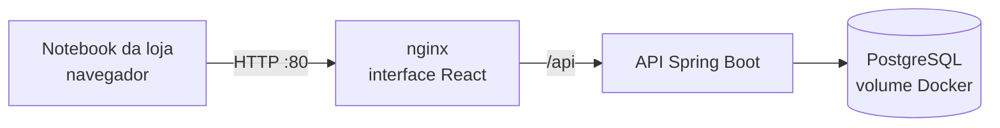

# Estoque Deadline

Sistema de estoque e vendas para a **Deadline**, loja física em Alegrete (RS). Antes, as vendas eram anotadas em um caderno. Agora há login por funcionário, controle de estoque em tempo real, histórico de vendas por dia, semana e mês, e tudo roda em um PC antigo da própria loja, com Linux e Docker.

Este repositório é a **porta de entrada do projeto**: reúne a orquestração de produção (Docker Compose) e a documentação de operação. O código-fonte fica em dois repositórios:

| Repositório | O que contém |
|---|---|
| [dead-line-store-spring](https://github.com/ericpatricio23/dead-line-store-spring) | API REST em Spring Boot (regras de negócio, segurança, testes) |
| [gerenciador-estoque-web](https://github.com/ericpatricio23/gerenciador-estoque-web) | Interface em React + TypeScript |

## Funcionalidades

- Cadastro, edição e exclusão de produtos (somente administrador)
- Registro de vendas com vários itens, baixando o estoque de forma atômica
- Login individual por funcionário, com perfis **Administrador** e **Funcionário**
- Histórico por dia, semana (segunda a domingo) e mês, somente para o administrador
- Cancelamento de venda com devolução automática do estoque
- Gestão de usuários pelo administrador

<!-- Adicionar prints em docs/img (com dados fictícios) -->

## Arquitetura



- Só o **nginx** publica porta. A API e o banco ficam em rede interna do Docker.
- O navegador fala com a interface e com a API no **mesmo endereço** (`/api`), o que dispensa CORS em produção.
- Os dados ficam em um **volume** Docker: recriar ou atualizar containers não apaga nada.

## Stack

Java 21 · Spring Boot 3 · Spring Security + JWT · PostgreSQL 16 · React · TypeScript · Vite · nginx · Docker Compose · GitHub Actions · GitHub Container Registry · Ubuntu Server

## Segurança

- Acesso por **perfis** (ADMIN e FUNCIONARIO); todas as rotas, exceto login e saúde, exigem token
- Senhas com BCrypt; chave JWT gerada por servidor, nunca no código
- Segredos apenas em um arquivo `.env` fora do Git (existe só o modelo `.env.example`)
- Containers executam **sem root** e têm *healthcheck*
- Servidor com firewall (`ufw`) liberando apenas SSH e HTTP, e SSH por chave
- Remover um usuário invalida o token dele imediatamente

## Qualidade e entrega contínua

- API com 64 testes automatizados e interface com 186, escritos antes do código (TDD)
- A cada push na `main`, o GitHub Actions roda os testes e, **só se passarem**, publica a imagem no `ghcr.io` com as etiquetas `latest` e `sha-<commit>` (permite voltar a uma versão anterior)

## Como subir

Requisitos: Docker com o plugin Compose.

```bash
git clone https://github.com/ericpatricio23/estoque-loja.git
cd estoque-loja
cp .env.example .env      # edite e troque TODOS os valores
docker compose up -d
```

O sistema fica em `http://<endereço-do-servidor>` (porta definida em `WEB_PORT`). O usuário `admin` é criado na **primeira** subida com a senha de `ADMIN_PASSWORD`.

Para atualizar para a versão mais recente:

```bash
docker compose pull
docker compose up -d
```

## Operação

O servidor é um PC antigo (all-in-one, 4 GB de RAM, HD) com Ubuntu Server, IP fixo e acesso remoto por SSH.

- **Horário:** a loja funciona de segunda a sábado; o PC é ligado de manhã e **desliga sozinho às 19h30** (ordenado, sem cortar o banco no meio de uma gravação)
- **Backup:** `pg_dump` diário às 19h05, validado (arquivo íntegro e com as tabelas esperadas), guardando 14 dias e 12 meses; restauração testada em um Postgres descartável. Cópia externa em planejamento
- **Fuso:** a API grava datas em `America/Sao_Paulo`, para que o total do dia não vire à noite
- **Recuperação:** os containers usam `restart: unless-stopped` e voltam sozinhos após queda de energia

## Decisões e aprendizados

- **Imagens públicas no `ghcr.io`:** o servidor baixa atualizações sem token que expire
- **Proxy no nginx em vez de CORS:** a interface chama `/api` na própria origem; o nginx remove o cabeçalho `Origin` ao repassar para a API
- **Teste de restauração antes de confiar no backup:** um backup nunca restaurado não é backup

## Próximos passos

Cópia externa e criptografada do backup, monitoramento, script de atualização com *rollback*, valores monetários em `BigDecimal` e migrações com Flyway.
